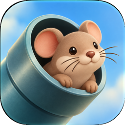

<p align="center">
  
</p>

# 鼠须管助手（SquirrelHelper）

[](https://github.com/pokoblin/squirrel-macos/releases)
[](LICENSE)


[鼠须管](https://github.com/rime/squirrel)（Squirrel，macOS 上的 [Rime](https://rime.im) 输入法）的图形界面助手。不用手写 YAML，点几下就能装好鼠须管、选方案、调外观、同步 macOS 文本替换，并把整套配置一键导出、在新电脑上一键导入。

*A GUI companion for [Squirrel](https://github.com/rime/squirrel) (Rime input method on macOS): install Squirrel, pick schemas, tweak appearance, sync macOS text replacements, and export/import your whole setup — no YAML editing required. The UI is Chinese-only for now.*

> [!NOTE]
> 这是个人项目，**不是**鼠须管 / Rime 官方出品。目前是预发布版本（0.1.x），欢迎试用和反馈。

## 目录

- [为什么做这个](#为什么做这个)
- [功能](#功能)
- [下载和安装](#下载和安装)
- [使用](#使用)
- [支持的方案](#支持的方案)
- [隐私](#隐私)
- [已知限制](#已知限制)
- [从源码构建](#从源码构建)
- [命令行工具 rimectl](#命令行工具-rimectl)
- [项目结构](#项目结构)
- [参与贡献](#参与贡献)
- [致谢](#致谢)
- [许可证](#许可证)

## 为什么做这个

鼠须管很好用，但上手门槛不低：要自己下载方案、改 `*.custom.yaml`、手动部署，换电脑时还得记得搬哪些文件。鼠须管助手想把这些事变成几次点击：

- **新手**：装好鼠须管、选一个起步方案，就能开始打字。
- **老用户**：接管已有的配置，之后在界面里改；换电脑时一键导出、一键导入，个人词库和输入习惯都带走。

## 功能

| | |
|---|---|
| **安装和引导** | 下载、校验、安装鼠须管，一步步带你在系统设置里添加输入法 |
| **方案** | 启用、排序（第一个是默认方案），调整方案的选项 |
| **外观** | 字号、候选个数、横排竖排、配色（可以分别设浅色、深色） |
| **文本替换** | 把「系统设置 → 键盘 → 文本替换」变成鼠须管的短语，打开应用时检查有没有变化 |
| **接管已有配置** | 认出你现有的 Rime 配置，先预览再接管，接管前完整备份 |
| **导出导入** | 设置、个人词库、手动短语、输入习惯打成一个 zip；导入时下载最新的上游方案并合并输入习惯 |
| **备份还原** | 每次应用改动前自动备份，随时还原 |
| **诊断** | 检查鼠须管有没有装好、启用、部署成功，告诉你下一步做什么 |

## 下载和安装

**要求**：macOS 27 或更新，Apple 芯片的 Mac。

1. 到 [Releases](https://github.com/pokoblin/squirrel-macos/releases) 下载 `SquirrelHelper-版本号.zip`。
2. 解压后把「鼠须管助手」拖进「应用程序」文件夹，然后打开。
3. 应用用 Developer ID 签名，并通过了苹果公证。第一次打开时系统会问「是从互联网下载的，确定要打开吗」，点「打开」。

想核对下载的文件，可以对比 Release 附件里的 `.sha256`：

```bash
shasum -a 256 SquirrelHelper-0.1.0.zip
```

应用名跟着系统语言：中文系统里显示「鼠须管助手」，其他语言显示 SquirrelHelper。

## 使用

第一次打开会一步步带你：

1. **安装鼠须管**：会弹出系统授权框，输入这台 Mac 的登录密码。已经装过的会跳过。
2. **添加输入法**：在系统设置里添加一次鼠须管（macOS 要求用户手动添加，应用会打开对应的设置页）。
3. **选择起点**，三选一：
   - 选一个起步方案；
   - 接管已有的配置；
   - 从导出文件导入。

之后打开应用就是主窗口。改完设置后点「应用改动」才会生效，应用会自动备份、写入配置并通知鼠须管重新部署。

## 支持的方案

应用本身不包含任何方案，使用时从上游下载：

| 方案 | 来源 | 许可证 |
|---|---|---|
| 雾凇拼音（全拼）、小鹤双拼、雾凇词库 | [iDvel/rime-ice](https://github.com/iDvel/rime-ice) | GPL-3.0 |
| 极点五笔 86（可和拼音混输） | [KyleBing/rime-wubi86-jidian](https://github.com/KyleBing/rime-wubi86-jidian) | Apache-2.0 |

起步方案有三个：雾凇拼音（全拼）、小鹤双拼、五笔 + 拼音混输。方案清单在 [`Sources/RimeKit/Resources/catalog.json`](Sources/RimeKit/Resources/catalog.json)，想加新方案欢迎提 issue 或 PR。

## 隐私

- 文本替换、个人词库只在你的电脑上处理，**不上传**。读文本替换不需要另外授权。
- 导出文件里不放文本替换生成的短语（同一个 Apple 账户在新电脑上会自动同步）。
- 应用只在安装鼠须管、下载方案时联网，都是从鼠须管和各方案的 GitHub 下载。没有统计、没有遥测。

## 已知限制

- 只支持 Apple 芯片；
- 界面只有中文；
- 还没有自己的图标；
- 应用不在后台常驻，文本替换的变化在打开应用时才检查；
- 诊断页的部分提示还是命令行 `rimectl` 的说法（发布包里没有 `rimectl`），以后改成界面上的做法。

更多待改进的地方见 [docs/backlog.md](docs/backlog.md)。

## 从源码构建

需要 Xcode 27（Swift 6）。

```bash
git clone https://github.com/pokoblin/squirrel-macos.git
cd squirrel-macos
swift build
```

跑单元测试（只用临时目录，不碰你的真实配置）：

```bash
swift test
```

打包成应用（输出到 `.build/app/SquirrelHelper.app`）：

```bash
./tools/app/build-app.sh
```

> [!WARNING]
> 应用和 `rimectl` 会安装鼠须管、改 `~/Library/Rime`、通知鼠须管部署。开发时建议在虚拟 Mac 里运行，别在自己日常用的电脑上试。本项目用 [Tart](https://tart.run/) 做测试虚拟机，工具和用法见 [tools/vm/README.md](tools/vm/README.md)。

联网检查上游方案的结构有没有变：

```bash
RIMEKIT_ONLINE=1 swift test --filter OnlineTests
```

发布流程见 [docs/release.md](docs/release.md)。

## 命令行工具 rimectl

`rimectl` 和应用共用同一套核心库，适合调试和写脚本（目前不随发布包提供，需要从源码构建）。所有命令都可以用 `--data-dir` 指定应用数据目录、`--rime-dir` 指定 Rime 用户目录，试用时请指向临时目录。

```bash
swift build
.build/debug/rimectl --help
```

| 命令 | 作用 |
|---|---|
| `catalog` / `fetch` | 列出方案清单 / 下载方案包 |
| `settings init\|show\|set` | 写入起步设置、查看、修改设置 |
| `generate --out 目录` | 按设置生成一份 Rime 配置（只往空目录写） |
| `apply` | 把设置应用到 Rime 目录并通知鼠须管部署 |
| `takeover [--confirm]` | 预览接管已有配置；加 `--confirm` 才真的接管 |
| `export` / `import` | 导出 / 导入整套配置 |
| `textreplacement status\|sync\|off` | 文本替换同步 |
| `status` / `restore` | 查看状态 / 列出和还原备份 |
| `install` / `activate` / `doctor` | 安装鼠须管 / 启用输入法 / 检查环境 |

例如在临时目录里试生成一份五笔 + 拼音混输的配置：

```bash
D=$(mktemp -d)
.build/debug/rimectl settings init wubi-pinyin --data-dir "$D"
.build/debug/rimectl generate --data-dir "$D" --out "$D/rime"
```

## 项目结构

```
Sources/
  RimeKit/           核心库：方案清单、下载、生成配置、部署、安装、接管、导出导入、文本替换
  rimectl/           命令行入口
  AppCore/           界面用的逻辑（不含 SwiftUI，可以单元测试）
  AppUI/             SwiftUI 视图
  SquirrelMacOSApp/  应用入口
Tests/RimeKitTests/  单元测试和联网测试
tools/
  app/               打包应用、应用图标（换图标见 make-icon.sh）
  release/           构建发布包
  vm/                测试虚拟机和测试小工具
docs/                设计、实测记录、已验证的事实
```

想深入了解，推荐按这个顺序读：

1. [第一版设计](docs/superpowers/specs/2026-10-15-squirrel-macos-v1-design.md)：整体架构和取舍。
2. [已验证的事实](docs/verified-facts.md)：鼠须管安装包、命令行参数、输入法启用、部署、日志、文本替换、上游方案等，每条都写了怎么验证的。
3. [从零安装的实测记录](docs/install-test-log.md)：在全新虚拟 Mac 里的完整过程。
4. [上游方案的目录结构](docs/upstream-layouts.md)、[路线图](docs/superpowers/plans/2026-10-15-roadmap.md)、[需求和已确认的决定](docs/requirements-draft.md)。

## 参与贡献

欢迎提 issue 和 PR：

- **报告问题**：请写上 macOS 版本、鼠须管版本、用的方案，以及诊断页显示的内容。不要贴文本替换、个人词库的内容。
- **提交代码**：
  - 提交前跑一遍 `swift test`；
  - 改 Rime 配置项前，先确认鼠须管真的支持这个键名（可以用 `strings` 查鼠须管的二进制）；
  - 会改动系统的测试（安装、启用输入法、写 `~/Library/Rime`）请在虚拟机里做；
  - 涉及鼠须管行为的结论，欢迎补充到 [docs/verified-facts.md](docs/verified-facts.md)，并写明怎么验证的。
- **加新方案**：先提 issue 说明方案的来源、许可证和目录结构。

## 致谢

- [Rime / 中州韵输入法引擎](https://rime.im) 和 [鼠须管](https://github.com/rime/squirrel)
- [雾凇拼音](https://github.com/iDvel/rime-ice)
- [极点五笔 for Rime](https://github.com/KyleBing/rime-wubi86-jidian)
- [Yams](https://github.com/jpsim/Yams)：YAML 解析
- [Tart](https://tart.run/)：测试用的 macOS 虚拟机

## 许可证

- 鼠须管助手以 [MIT 许可证](LICENSE) 发布。
- 用到的第三方库见 [THIRD-PARTY-NOTICES.md](THIRD-PARTY-NOTICES.md)。
- 输入方案不随应用分发，许可证以各上游项目为准。
