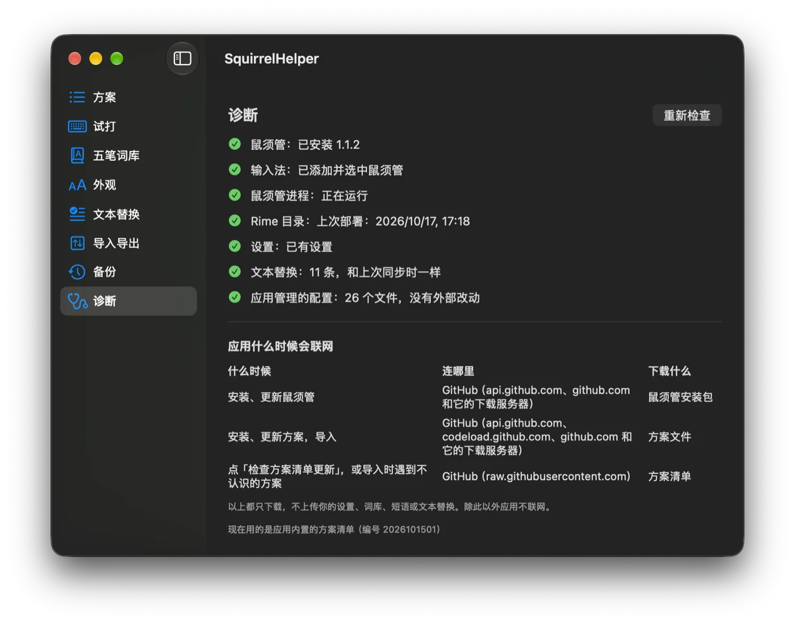

<p align="center">
  
</p>

<h1 align="center">鼠须管助手（SquirrelHelper）</h1>

<p align="center">
  <a href="https://github.com/rime/squirrel">鼠须管</a>（macOS 上的 <a href="https://rime.im">Rime</a> 输入法）的图形界面助手<br>
  不用手写 YAML：装鼠须管、选方案、调外观、编五笔词库、同步文本替换，换电脑一键搬家
</p>

<p align="center">
  <a href="https://github.com/pokoblin/squirrel-macos/releases/latest"></a>
  <a href="LICENSE"></a>
  
  
</p>

<p align="center">
  <a href="https://github.com/pokoblin/squirrel-macos/releases/latest"><b>下载</b></a> ·
  <a href="#功能">功能</a> ·
  <a href="#常见问题">常见问题</a> ·
  <a href="#从源码构建">从源码构建</a> ·
  <a href="#english">English</a>
</p>

<p align="center">
  
</p>

> [!NOTE]
> 这是个人项目，**不是**鼠须管 / Rime 官方出品。欢迎试用和反馈。

## 为什么做这个

鼠须管很好用，但上手门槛不低：要自己下载方案、改 `*.custom.yaml`、手动部署，换电脑时还得记得搬哪些文件。鼠须管助手把这些事变成几次点击：

- **新手**：装好鼠须管、选一个起步方案，就能开始打字。
- **老用户**：接管已有的配置，之后在界面里改；换电脑时一键导出、一键导入，个人词库和输入习惯都带走。

## 功能

| | |
|---|---|
| **安装和引导** | 下载、校验、安装鼠须管，一步步带你在系统设置里添加输入法 |
| **方案** | 启用、排序（第一个是默认方案）、调整方案选项；方案清单可以在线更新，不用等应用发新版 |
| **试打** | 在应用里输入编码，直接看候选、翻页、选词；可以在「应用改动」之前先看效果 |
| **五笔词库** | 加词时自动算五笔编码、选排第几位；批量导入；检查每个词能不能打出来（极点五笔） |
| **外观** | 字号、候选个数、横排竖排、配色（可以分别设浅色、深色） |
| **文本替换** | 把「系统设置 → 键盘 → 文本替换」变成鼠须管的短语，打开应用时检查有没有变化 |
| **接管已有配置** | 认出你现有的 Rime 配置，先预览再接管，接管前完整备份 |
| **导出导入** | 设置、个人词库、手动短语、输入习惯打成一个 zip；在新电脑上导入时下载最新的上游方案并合并输入习惯 |
| **备份还原** | 每次应用改动前自动备份，随时还原 |
| **诊断** | 检查鼠须管有没有装好、启用、部署成功，告诉你下一步做什么；列出应用会在什么时候联网 |

## 安装

**要求**：macOS 27 或更新，Apple 芯片的 Mac。

1. 到 [Releases](https://github.com/pokoblin/squirrel-macos/releases/latest) 下载 `SquirrelHelper-版本号.dmg`。
2. 打开 dmg，把「鼠须管助手」拖到旁边的「应用程序」文件夹，然后从「应用程序」里打开。
3. 第一次打开时系统会问「是从互联网下载的，确定要打开吗」，点「打开」。应用用 Developer ID 签名，并通过了苹果公证。

想核对下载的文件，可以和 Release 附件里的 `.sha256` 对比：

```bash
shasum -a 256 SquirrelHelper-版本号.dmg
```

应用名跟着系统语言：中文系统里显示「鼠须管助手」，其他语言显示 SquirrelHelper。

## 上手

第一次打开会一步步带你：

1. **安装鼠须管**：弹出系统授权框，输入这台 Mac 的登录密码。已经装过的会跳过。
2. **添加输入法**：在系统设置里添加一次鼠须管。应用会打开对应的设置页，并自动发现你加好了。
3. **选择起点**，三选一：
   - 选一个起步方案（雾凇拼音、小鹤双拼、五笔 + 拼音混输）；
   - 接管已有的配置；
   - 从导出文件导入。

之后打开应用就是主窗口。改完设置后点「应用改动」才会生效：应用会先备份，再写入配置、通知鼠须管重新部署。

## 支持的方案

应用本身不包含任何方案，使用时从上游下载：

| 方案 | 来源 | 许可证 |
|---|---|---|
| 雾凇拼音（全拼）、小鹤双拼、雾凇词库 | [iDvel/rime-ice](https://github.com/iDvel/rime-ice) | GPL-3.0 |
| 极点五笔 86（可和拼音混输） | [KyleBing/rime-wubi86-jidian](https://github.com/KyleBing/rime-wubi86-jidian) | Apache-2.0 |

方案清单在 [`Sources/RimeKit/Resources/catalog.json`](Sources/RimeKit/Resources/catalog.json)，同时签名发布在 [`catalog/v1/`](catalog/v1/)。在「方案」页点「检查方案清单更新」就能用上新加的方案。想加新方案，欢迎提 issue 或 PR。

## 隐私

- 文本替换、个人词库只在你的电脑上处理，**不上传**。读文本替换不需要另外授权。
- 导出文件里不放文本替换生成的短语（同一个 Apple 账户在新电脑上会自动同步）。
- 应用只在安装鼠须管、下载方案、检查方案清单更新时联网，都是从 GitHub 下载，不上传任何内容。**没有统计、没有遥测。**「诊断」页列出了每种联网的时机和地址。
- 方案清单带签名，签名验不过就不用。

## 常见问题

<details>
<summary><b>为什么要我自己去系统设置里添加输入法？</b></summary>

macOS 不允许程序替用户启用第三方输入法，这一步只能你亲手做一次。应用会打开对应的设置页，加好后自动继续。
</details>

<details>
<summary><b>装好鼠须管后，输入法菜单里没有它，或者打出来还是英文</b></summary>

注销再登录一次。刚装好鼠须管时，macOS 有时要这样才认得出它。
</details>

<details>
<summary><b>会不会弄坏我现有的配置？</b></summary>

- 接管前会先给你看预览：哪些文件会被换掉、哪些原样保留、带过去哪些个人词库和短语。你确认了才动手，动手前完整备份一次，这份永久保留。
- 之后每次「应用改动」前都自动备份，在「备份」页可以还原。
- 应用只管自己写的文件。你在应用外改过这些文件时，应用会先问你怎么办，不会悄悄覆盖。

保险起见，第一次接管前也可以自己复制一份 `~/Library/Rime`。
</details>

<details>
<summary><b>试打页能看出字号、配色的变化吗？</b></summary>

不能。候选窗口是鼠须管自己画的，试打页只显示候选内容。字号、配色要在真的打字时看。
</details>

<details>
<summary><b>数据存在哪里？怎么卸载？</b></summary>

- 应用的设置、个人内容、下载的方案和备份都在 `~/Library/Application Support/squirrel-macos`。
- 卸载：删掉「应用程序」里的鼠须管助手和上面这个目录。已经写进 `~/Library/Rime` 的配置会留下，鼠须管照常能用。
</details>

## 已知限制

- 只支持 Apple 芯片；
- 界面只有中文；
- 词库编辑器目前只支持极点五笔；
- 应用不在后台常驻，文本替换的变化在打开应用时才检查；
- 诊断页的部分提示还是命令行 `rimectl` 的说法（发布包里没有 `rimectl`）。

遇到问题请到 [Issues](https://github.com/pokoblin/squirrel-macos/issues) 反馈。

## 路线图

- [x] 在线方案清单
- [x] 试打预览
- [x] 五笔个人词库编辑器
- [ ] 按键设置：翻页键、方案切换快捷键、Shift 切换中英
- [ ] 拼音词库和手动短语的编辑
- [ ] iCloud 同步（还在考虑）

## 从源码构建

需要 Xcode 27（Swift 6）。

```bash
git clone https://github.com/pokoblin/squirrel-macos.git
cd squirrel-macos
swift build
swift test                   # 单元测试，只用临时目录，不碰你的真实配置
./tools/app/build-app.sh     # 打包成 .build/app/SquirrelHelper.app
```

> [!WARNING]
> 应用和 `rimectl` 会安装鼠须管、改 `~/Library/Rime`、通知鼠须管部署。开发时建议在虚拟 Mac 里运行，别在自己日常用的电脑上试。本项目用 [Tart](https://tart.run/) 做测试虚拟机，工具和用法见 [tools/vm/README.md](tools/vm/README.md)。

联网检查上游方案的结构有没有变：

```bash
RIMEKIT_ONLINE=1 swift test --filter OnlineTests
```

发布包用 `tools/release/build-release.sh` 构建（需要 Developer ID 证书和公证凭据，用法见脚本开头的注释）。

### 命令行工具 rimectl

`rimectl` 和应用共用同一套核心库，适合调试和写脚本（不随发布包提供，要从源码构建）。所有命令都可以用 `--data-dir` 指定应用数据目录、`--rime-dir` 指定 Rime 用户目录，试用时请指向临时目录。

| 命令 | 作用 |
|---|---|
| `catalog` / `fetch` | 方案清单 / 下载方案包 |
| `settings init\|show\|set` | 写入起步设置、查看、修改设置 |
| `generate --out 目录` | 按设置生成一份 Rime 配置（只往空目录写） |
| `apply` | 把设置应用到 Rime 目录并通知鼠须管部署 |
| `takeover [--confirm]` | 预览接管已有配置；加 `--confirm` 才真的接管 |
| `export` / `import` | 导出 / 导入整套配置 |
| `textreplacement status\|sync\|off` | 文本替换同步 |
| `status` / `restore` | 查看状态 / 列出和还原备份 |
| `install` / `activate` / `doctor` | 安装鼠须管 / 启用输入法 / 检查环境 |
| `preview` | 在配置副本上试打 |
| `wubi encode\|list\|add\|remove\|import\|check` | 五笔个人词库 |

例如在临时目录里生成一份五笔 + 拼音混输的配置：

```bash
D=$(mktemp -d)
.build/debug/rimectl settings init wubi-pinyin --data-dir "$D"
.build/debug/rimectl generate --data-dir "$D" --out "$D/rime"
```

### 项目结构

```
Sources/
  RimeKit/              核心库：方案清单、下载、生成配置、部署、安装、接管、导出导入、文本替换、五笔词库
  RimeGuard/            防止误碰真实 ~/Library/Rime 的检查
  AppCore/              界面用的逻辑（不含 SwiftUI，可以单元测试）
  AppUI/                SwiftUI 视图
  SquirrelMacOSApp/     应用入口
  rime-preview-helper/  试打用的辅助进程：加载鼠须管自带的 librime，只在配置副本上运行
  RimePreviewProtocol/  应用和辅助进程之间的消息格式
  CRimeAPI/             librime 的 C 接口声明
  rimectl/              命令行入口
Tests/RimeKitTests/     单元测试和联网测试
catalog/v1/             签名发布的在线方案清单
tools/
  app/                  打包应用、应用图标
  release/              构建、检查发布包
  catalog/              签名发布方案清单
  vm/                   测试虚拟机和测试小工具
```

## 参与贡献

欢迎提 issue 和 PR：

- **报告问题**：请写上 macOS 版本、鼠须管版本、用的方案，以及诊断页显示的内容。**不要**贴文本替换、个人词库的内容。
- **提交代码**：
  - 提交前跑一遍 `swift test`；
  - 改 Rime 配置项前，先确认鼠须管真的支持这个键名（可以用 `strings` 查鼠须管的二进制）；
  - 会改动系统的测试（安装、启用输入法、写 `~/Library/Rime`）请在虚拟机里做；
  - 涉及鼠须管行为的结论，请在 PR 里写明是怎么验证的。
- **加新方案**：先提 issue 说明方案的来源、许可证和目录结构。

## 致谢

- [Rime / 中州韵输入法引擎](https://rime.im) 和 [鼠须管](https://github.com/rime/squirrel)
- [雾凇拼音](https://github.com/iDvel/rime-ice)
- [极点五笔 for Rime](https://github.com/KyleBing/rime-wubi86-jidian)
- [Yams](https://github.com/jpsim/Yams)：YAML 解析
- [Tart](https://tart.run/)：测试用的 macOS 虚拟机

## 许可证

- 鼠须管助手以 [MIT 许可证](LICENSE) 发布。
- 用到的第三方库见 [THIRD-PARTY-NOTICES.md](THIRD-PARTY-NOTICES.md)。
- 输入方案不随应用分发，许可证以各上游项目为准。

## English

SquirrelHelper is a GUI companion for [Squirrel](https://github.com/rime/squirrel), the [Rime](https://rime.im) input method on macOS. It installs Squirrel, lets you pick and reorder schemas, try typing before applying changes, edit your Wubi user dictionary, tweak appearance, sync macOS text replacements, and export/import your whole setup — no YAML editing required. It is an unofficial personal project; the UI is Chinese-only for now. Requires macOS 27+ on Apple silicon. Download the signed and notarized dmg from [Releases](https://github.com/pokoblin/squirrel-macos/releases/latest).
